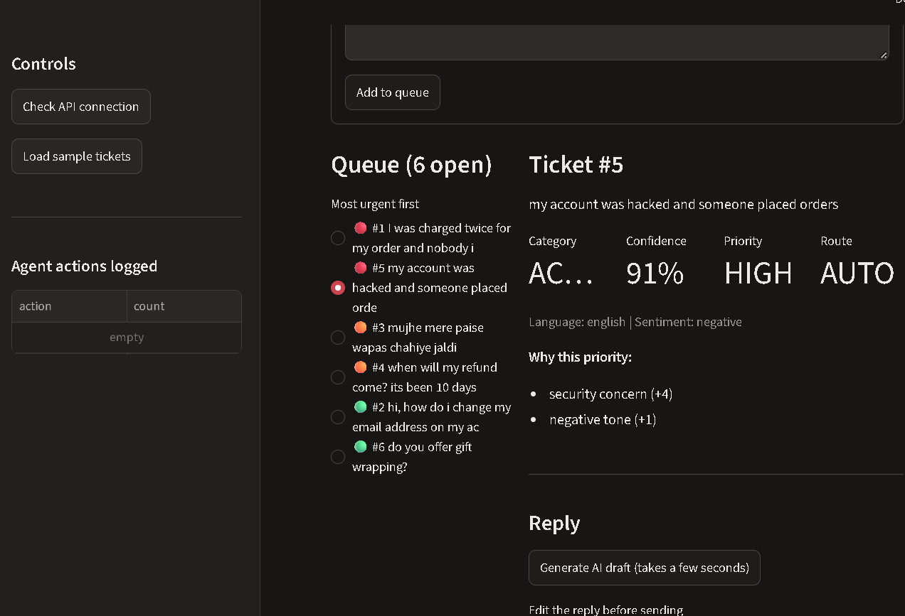
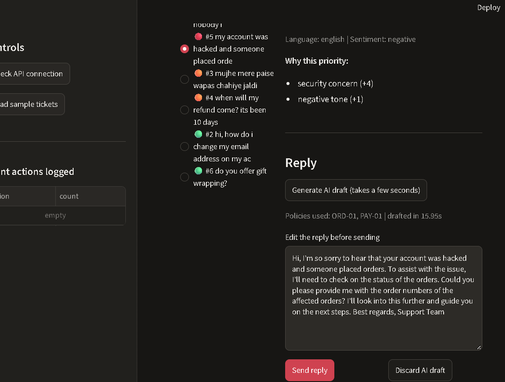

# AI Ticket Triage and Response Drafting System

A customer-support assistant that classifies incoming tickets, suggests a priority with
reasons, finds the relevant policy, and drafts a reply for a human agent to review.
English, with basic Hinglish (Hindi-English) support.

**Coming soon** [(https://huggingface.co/datasets/bitext/Bitext-customer-support-llm-chatbot-training-dataset)]

## How it works

1. A ticket comes in (through the dashboard or the API).
2. **Classify** it into one of 11 categories with an ensemble of two models
   (multilingual sentence embeddings + character n-gram TF-IDF).
3. **Suggest a priority** (HIGH, MEDIUM, LOW) with reasons, using rules plus a sentiment model.
4. **Route**: if the model's confidence is low, the ticket is flagged for human review.
5. **Retrieve** the most relevant policies from a small knowledge base using sentence embeddings.
6. **Draft** a reply with a local LLM (Ollama, llama3.2:3b) that may use only the retrieved policies.
   If no policy matches, it says it will check with the team instead of guessing.
7. The agent edits, sends, or discards the draft. Every decision is logged to a SQLite database.

## Features

- 11-category ticket classifier with confidence-based routing
- Suggested priority with the reasons shown to the agent
- Retrieval-grounded drafts that list the policies they used, plus a "no matching policy" guard
- Basic Hinglish handling
- FastAPI backend and Streamlit agent dashboard (human-in-the-loop)
- Feedback log (sent unchanged / edited / rejected) in SQLite
- Falls back to a template reply if the LLM is not available

## Results

Training data: the Bitext 27K customer-support dataset, which is synthetic and template-based.
**All test sets are small and were written with an AI tool, so treat these numbers as
rough indications, not precise measurements.** 

| Measurement | Result |
|---|---|
| Category accuracy, my 33-ticket development set, first model, original labels | 72.7% (24/33) |
| Same set, 4 labels corrected to the dataset's category definitions, model retrained with targeted examples | 97.0% (32/33). **Optimistic**: the fixes and extra training examples followed these failures |
| **Category accuracy, fresh holdout (15 tickets)** | **73.3% (11/15)**. About 80% (12/15) if one CANCEL/ORDER definition mismatch is counted by the dataset's definition. At this sample size the plausible range is wide, roughly 50% to 90% |
| Priority accuracy, development set / holdout | 54.5% (18/33) / 26.7% (4/15). A simple keyword rule scored 46.7% (7/15) on the holdout |
| Urgent (HIGH) tickets found, development set / holdout | 3 of 5 / 0 of 2 (keyword rule on the holdout: 1 of 2) |
| Retrieval hit rate (a matching policy in the top 2), development set / holdout | 77% (23/30) / 79% (11/14) |
| Triage time | about 40 to 60 ms per ticket on a laptop CPU (classification and priority only, not AI drafting) |
| Hinglish | tested on only 5 tickets (4 correct) in the development set and none in the holdout, so there is no reliable Hinglish accuracy |

The evaluation reports are in the `results/` folder.

## What I learned from the evaluation

- The system looked excellent on tickets I used while improving it (97%) and clearly worse on tickets
  it had never seen (73%). Part of the gap was my own labels not matching the dataset's category
  definitions, part was missing training examples, and part was my urgency rules not generalizing.
- Confidence was only a partial safety net. On the holdout, 3 of the 4 errors had confidence of 0.64 or higher.
- My hand-written priority rules scored 100% on tickets I wrote and 27% on a fresh set. The
  simple keyword rule beat them, so priority is shown to agents as a suggestion only.

## Design decisions

- Compared word-based, embedding-based, and character-based classifiers, then ensembled the last two.
- Used a local model so the project costs nothing, and added a retrieval-score guard because
  small models tend to make things up.
- Kept a human in the loop: the AI proposes, the agent decides, and the decision is logged.

## Limitations

- On a fresh holdout of 15 hand-written English tickets, category accuracy was 73.3%, well below
  the 97% on the development set. The development result was optimistic because fixes followed those failures.
- Both the training data and the test tickets are synthetic or AI-written, so real customer
  messages (typos, slang, several issues in one message) will likely be harder. [ADJUST IF final_test.py WAS WRITTEN BY YOU.]
- One holdout error was a label mismatch: in this dataset "cancel an order" belongs to ORDER,
  and CANCEL covers only cancellation-fee questions.
- Priority scoring is the weakest part. On the holdout it rated 8 of its 11 mistakes too low,
  including both urgent tickets ("unknown device", "charged three times"). Priority labels are subjective.
- Hinglish was tested on 5 tickets only. Hinglish sentiment uses a short word list and the
  Hinglish detector is rule-based. After retraining, one Hinglish ticket that used to work
  ("Kisi real person se baat karni hai...") became a mistake.
- The knowledge base is small and fictional, and draft quality was not formally evaluated.
- The local 3B model writes weaker drafts than a hosted model.

## Next steps

- Collect agent corrections from the feedback log and train a priority model from them.
- Test on real tickets, including many more Hinglish ones.
- Expand the knowledge base and evaluate draft quality with a rubric.

## Run it yourself

1. Install Python 3.11, then run `python -m venv venv`, `venv\Scripts\activate`,
   and `pip install -r requirements.txt`.
2.2. Download the Bitext customer-support dataset from [Hugging Face](https://huggingface.co/datasets/bitext/Bitext-customer-support-llm-chatbot-training-dataset) (the 27K responses CSV file) and save it as `data/tickets.csv`.
3. Train the classifiers: `python train_multilingual.py`, then `python train_hybrid.py`.
4. Install Ollama (ollama.com), then run `ollama pull llama3.2:3b`.
5. Start the API: `uvicorn api:app`
6. In a second terminal, start the dashboard: `streamlit run dashboard.py`

The first run downloads several models from Hugging Face, so it needs an internet connection.

## Project structure

- `triage.py`: classification, routing, and priority
- `urgency.py`, `sentiment.py`, `language.py`: priority scoring and Hinglish detection
- `retrieve_embed.py`, `knowledge_base.py`: policy retrieval
- `draft.py`: reply drafting with the local LLM
- `api.py`: FastAPI backend
- `dashboard.py`: Streamlit agent dashboard
- `train_*.py`, `compare_models.py`: training and model comparison
- `evaluate_*.py`, `final_test.py`, `holdout.py`: evaluation
- `LABEL_CHANGES.md`: record of the labels I corrected
- `results/`: saved evaluation reports

## Tech

Python, scikit-learn, sentence-transformers, Hugging Face Transformers, FastAPI,
Streamlit, SQLite, Ollama.

## Credits

Training data: [Bitext customer-support dataset](https://huggingface.co/datasets/bitext/Bitext-customer-support-llm-chatbot-training-dataset) by Bitext. The dataset page lists the license as CDLA-Sharing-1.0, so please read it there.